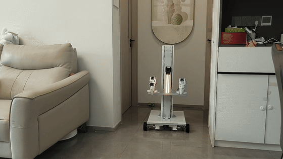
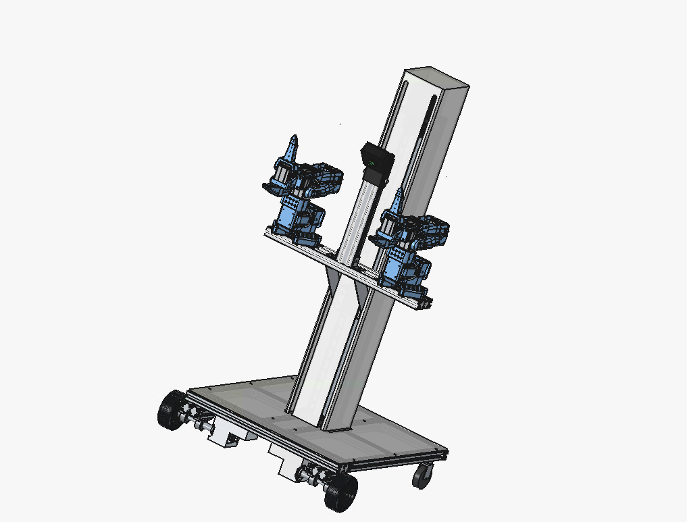
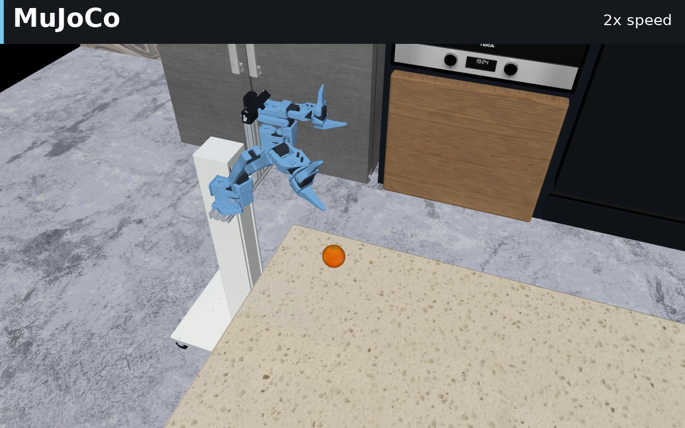
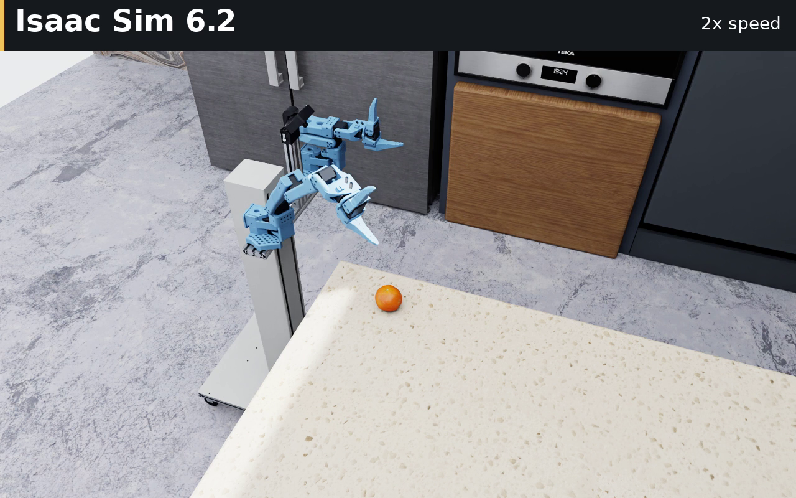

# LeNeo · Mobile Lifting Robot

[简体中文](README.md) | **English**

LeNeo is a low-cost, high-strength wheeled mobile robot with a lifting column, available in single-arm and dual-arm configurations. Its mobile base, vertical lift, and robotic arms enable manipulation from floor level to countertops.

## Hardware Features

- **Aluminum extrusion structure**: The main load-bearing structure uses aluminum extrusions for strength, load capacity, and easy assembly and expansion.
- **Mobility + vertical lift + manipulation**: The mobile base and lift extend the arms' working range.
- **Single-arm or dual-arm configurations**: Choose the configuration that fits your tasks and budget.

| Configuration | Price |
|---|---|
| Single arm | **CNY 1,000+ (excluding the main controller)** |
| Dual arm | **Under CNY 2,500** |

## 3D Assembly Files

[Download the LeNeo assembly (STEP)](hardware/leneo.step) · [Browse STL parts](hardware/stl)

[View the bill of materials online (Chinese)](hardware/BOM.md) · [Download the original Word document (Chinese)](hardware/LeNeo配件清单.docx)

## Assembly Tutorial

[▶ LeNeo mobile lifting robot assembly tutorial (Bilibili, Chinese)](https://www.bilibili.com/video/BV1PHsh6dEi9/)

Real robot control code is available in [`software/lerobot`](software/lerobot).

## Simulation Demo

**MuJoCo** and **Isaac Sim 6.2** demos pick up an orange from the floor and place it on a countertop. The demos currently use assisted grasping. See the [simulation guide (Chinese)](simulation/README.md) for instructions and technical details.

| MuJoCo | Isaac Sim 6.2 |
| :---: | :---: |
|  |  |

## Community

Scan the QR code to join the **LeNeo WeChat discussion group** and exchange assembly, setup, and usage tips.

## Repository Structure

| Directory | Contents |
|---|---|
| `hardware/` | 3D assembly, STL parts, preview image, and bill of materials; [assembly tutorial](https://www.bilibili.com/video/BV1PHsh6dEi9/) |
| `software/` | Real robot control code in [`software/lerobot`](software/lerobot) |
| `simulation/` | Code, robot models, and scene assets for both simulators |
| `docs/` | Simulation images and validation reports |

## License

[Apache-2.0](LICENSE). See the [asset notes (Chinese)](simulation/ASSETS.md) for third-party sources and licenses.

You are welcome to use and improve LeNeo. If you use this project's design files or code, please retain the original copyright, license, and attribution notices. We also welcome a credit and link to [llros007/leneo](https://github.com/llros007/leneo) in your project's README. See [NOTICE](NOTICE) for attribution information.
