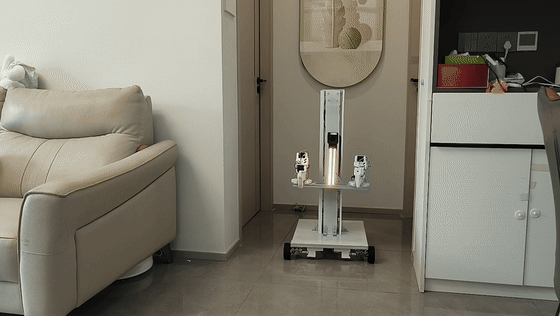
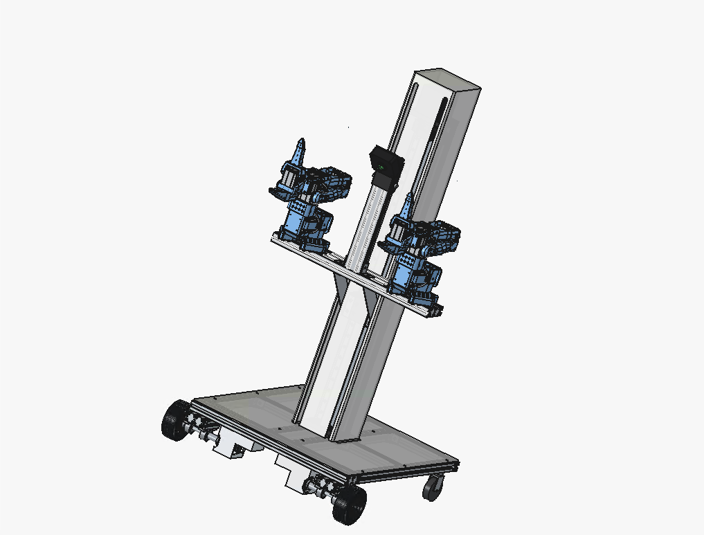
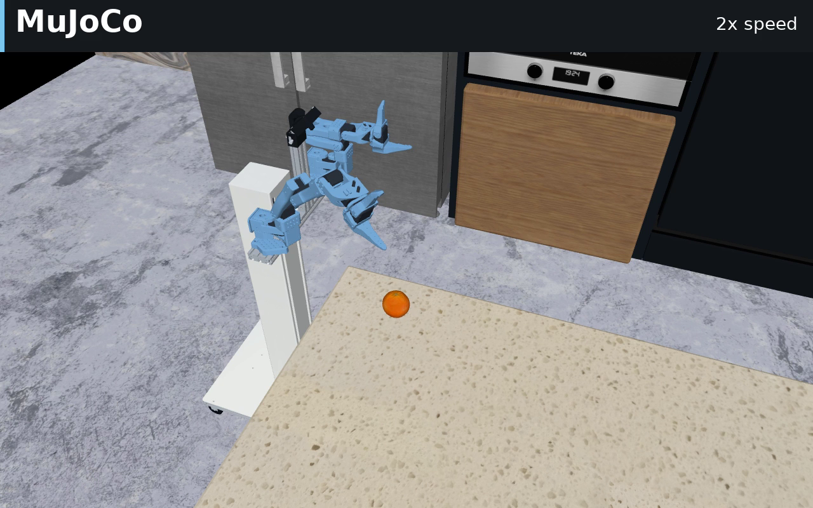
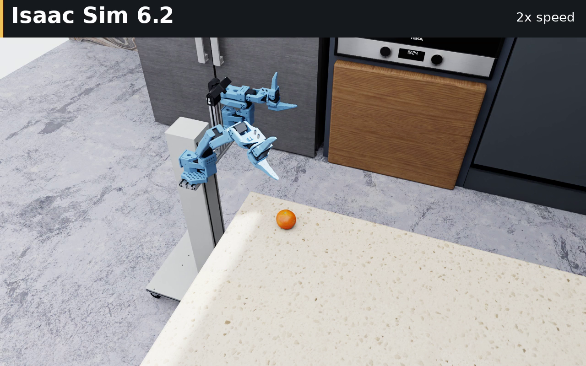

# LeNeo · 移动升降机器人

LeNeo 是一款低成本、高强度的轮式移动升降机器人，支持单臂和双臂配置。集成移动底盘、垂直升降与机械臂，可覆盖地面到台面的操作空间。

## 硬件特点

- **铝型材主结构**：主承力结构采用铝型材，承重能力强、结构强度高，便于装配和扩展。
- **移动 + 升降 + 操作**：底盘移动配合垂直升降，扩大机械臂的作业范围。
- **单臂 / 双臂可选**：按任务需求选择配置，控制搭建成本。

| 配置 | 价格 |
|---|---|
| 单臂版 | **1000+ 元（不含主控）** |
| 双臂版 | **不到 2500 元** |

## 3D 装配文件

[下载 LeNeo 3D 装配文件（STEP 压缩包）](hardware/leneo.step.zip)

**装配说明、BOM 清单及实机控制软件即将上传，敬请期待！**

## 仿真演示

支持 **MuJoCo** 和 **Isaac Sim 6.2**：从地面拾取橙子并放到吧台。当前采用辅助夹持，运行方法与技术说明见 [仿真使用说明](simulation/README.md)。

| MuJoCo | Isaac Sim 6.2 |
| :---: | :---: |
|  |  |

## 项目目录

| 目录 | 内容 |
|---|---|
| `hardware/` | 3D 装配文件与预览图；装配说明和 BOM 清单即将上传 |
| `software/` | 实机控制软件即将上传，敬请期待！ |
| `simulation/` | 两套仿真代码、模型与场景资源 |
| `docs/` | 仿真图片与验证报告 |

## 许可

[Apache-2.0](LICENSE)。第三方资源来源与许可见 [资产说明](simulation/ASSETS.md)。

欢迎参考和改进 LeNeo。若使用本项目的设计文件或代码，请保留原有版权、许可及来源信息；欢迎在项目 README 中注明来源并链接本仓库：[llros007/leneo](https://github.com/llros007/leneo)。署名信息见 [NOTICE](NOTICE)。
