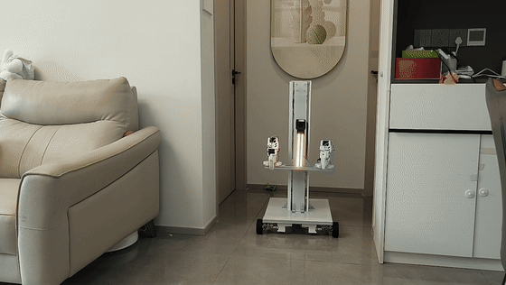
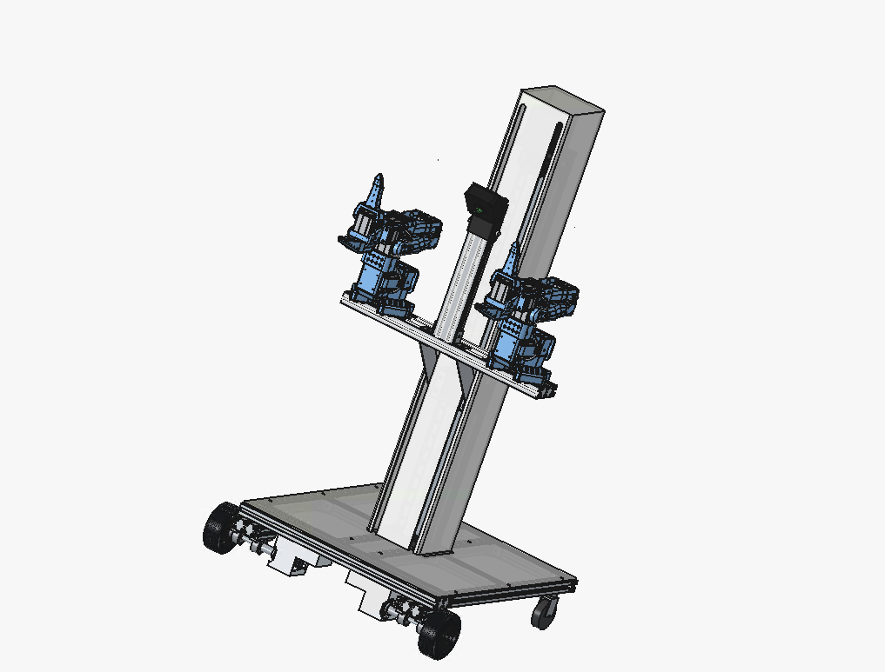
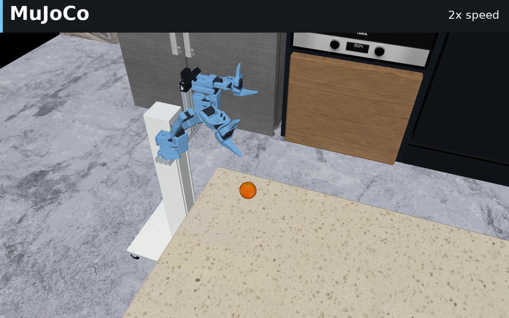
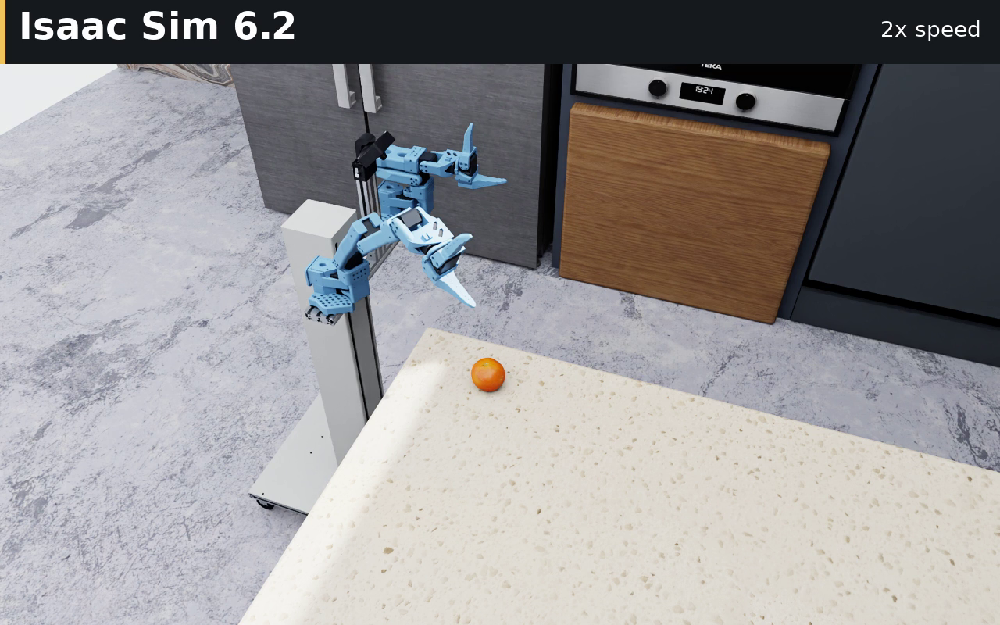

# LeNeo · 移动升降机器人

LeNeo 是一款低成本、高强度的轮式移动升降机器人，支持单臂和双臂配置。集成移动底盘、垂直升降与机械臂，可覆盖地面到台面的操作空间。

## 硬件特点

- **铝型材主结构**：主承力结构采用铝型材，承重能力强、结构强度高，便于装配和扩展。
- **移动 + 升降 + 操作**：底盘移动配合垂直升降，扩大机械臂的作业范围。
- **单臂 / 双臂可选**：按任务需求选择配置，控制搭建成本。

| 配置 | 价格 |
|---|---|
| 单臂版 | **1000+ 元（不含主控）** |
| 双臂版 | **不到 2500 元** |

## 3D 装配文件

[下载 LeNeo 3D 装配文件（STEP）](hardware/leneo.step)

[在线查看 BOM 配件清单](hardware/BOM.md) · [下载 Word 原文件](hardware/LeNeo配件清单.docx)

## 装配教程

[▶ 开源！移动升降机器人 LeNeo 装配教程（哔哩哔哩）](https://www.bilibili.com/video/BV1PHsh6dEi9/)

实机控制代码见 [`software/lerobot`](software/lerobot)。

## 仿真演示

支持 **MuJoCo** 和 **Isaac Sim 6.2**：从地面拾取橙子并放到吧台。当前采用辅助夹持，运行方法与技术说明见 [仿真使用说明](simulation/README.md)。

| MuJoCo | Isaac Sim 6.2 |
| :---: | :---: |
|  |  |

## 交流讨论

欢迎扫码加入 **LeNeo 微信交流群**，一起交流装配、调试和使用经验。

## 项目目录

| 目录 | 内容 |
|---|---|
| `hardware/` | 3D 装配文件、预览图与 BOM 配件清单；[装配教程](https://www.bilibili.com/video/BV1PHsh6dEi9/) |
| `software/` | 实机控制代码，见 [`software/lerobot`](software/lerobot) |
| `simulation/` | 两套仿真代码、模型与场景资源 |
| `docs/` | 仿真图片与验证报告 |

## 许可

[Apache-2.0](LICENSE)。第三方资源来源与许可见 [资产说明](simulation/ASSETS.md)。

欢迎参考和改进 LeNeo。若使用本项目的设计文件或代码，请保留原有版权、许可及来源信息；欢迎在项目 README 中注明来源并链接本仓库：[llros007/leneo](https://github.com/llros007/leneo)。署名信息见 [NOTICE](NOTICE)。
