# LeNeo 配件清单

配件规格、数量、采购链接及安装备注。内容来自原始配件清单。

[下载 Word 原文件](LeNeo配件清单.docx)

## 一、铝型材及盖板

| 序号 | 名称 | 规格 | 数量 | 图片 | 采购链接及安装备注 |
| --- | --- | --- | --- | --- | --- |
| 1 | 2060铝型材 | 20×60 mm 400 mm×2；60 mm×2 | 4根 | — | 400 mm：底盘前横梁、机械臂升降横梁；60 mm：前轮轴承座交叉支撑。 [购买链接](<https://item.taobao.com/item.htm?id=694246765556>) |
| 2 | 2040铝型材 | 20×40 mm；长220 mm | 1根 | — | 摄像头立柱。 — |
| 3 | 2020铝型材 | 20×20 mm 400 mm×5；140 mm×2 | 7根 | — | 400 mm：底盘四根纵梁、后横梁；140 mm：底盘中间横撑。 — |
| 4 | 铝型材端面盖板 | 2020欧标；塑胶；灰白色；厚3 mm | — | [图1](#figure-1) | [购买链接](<https://item.taobao.com/item.htm?id=588545025339&skuId=4983923518602>) |

## 二、角码及连接件

| 序号 | 名称 | 规格 | 数量 | 图片 | 采购链接及安装备注 |
| --- | --- | --- | --- | --- | --- |
| 5 | 加厚长孔角码 | 镀锌；48×48 mm | 10个装 | [图2](#figure-2) | [购买链接](<https://item.taobao.com/item.htm?id=873368215029&mi_id=00000MiTZybNhVGDdsY_b1_6lGGx0F5wI15x0zb6UssKiPU>) |
| 6 | 不锈钢多功能角码 | 中号；90°；102×102 mm；厚约2 mm | 2个 | [图3](#figure-3) | [购买链接](<https://item.taobao.com/item.htm?id=755009351073&skuId=5374375682025>) |
| 7 | 垂直角件连接角 | 2020A-2孔；90°；20×20 mm；宽18 mm；通孔5.5 mm；厚3 mm | 2个 | [图4](#figure-4) | [购买链接](<https://item.taobao.com/item.htm?id=859453077050>) |
| 8 | 三面固定角码 | 2.0款；98.5×98.5×29 mm | 8个 | [图5](#figure-5) | [购买链接](<https://item.taobao.com/item.htm?id=1033341013990>) |
| 9 | 铝型材地脚半圆连接件 | M8孔；尺寸37／24／50／18 mm；厚8 mm | 2个 | [图6](#figure-6) | [购买链接](<https://item.taobao.com/item.htm?id=987244787097&skuId=6119020218891>) |
| 10 | 万能连接片 | 25／30／40／50 mm，混合四种尺寸 | 40片；订单1份 | [图21](#figure-21) | — |
| 11 | 2028单角码 | 2028；铝合金；90° | 20个 | [图28](#figure-28) | — |

## 三、行走及传动部件

| 序号 | 名称 | 规格 | 数量 | 图片 | 采购链接及安装备注 |
| --- | --- | --- | --- | --- | --- |
| 12 | 橡胶轮胎及联轴器 | 85 mm实心轮；8 mm孔径抱紧式六角联轴器；轮宽33.4 mm | 2个 | [图7](#figure-7) | [购买链接](<https://detail.tmall.com/item.htm?id=670160152244&skuId=5905065115808>) |
| 13 | 钢制法兰联轴器及舵盘连接件 | 外径10 mm；内径5 mm | 2个 | [图8](#figure-8) [图9](#figure-9) [图10](#figure-10) | [购买链接](<https://detail.tmall.com/item.htm?id=758105724276&skuId=5230452761613>) |
| 14 | 立式外球面轴承座 | KP08 | 4个 | [图11](#figure-11) | [购买链接](<https://item.taobao.com/item.htm?id=692641960160&skuId=4922699709879>) |
| 15 | 轴承钢硬轴／光轴 | 直径8 mm；长80 mm | 5只 | [图12](#figure-12) | [购买链接](<https://detail.tmall.com/item.htm?id=704680011508&skuId=4954741400017>) |
| 16 | 刚性联轴器 | D20L25；内孔8×10 | 2个 | [图13](#figure-13) | [购买链接](<https://item.taobao.com/item.htm?id=627007996328&skuId=4453144308900>) |
| 17 | GX80双导轨滚珠丝杆滑台 | 1605；有效行程600 mm；不含电机 | —；订单1份 | [图14](#figure-14) | 联系商家配42/57步进电机通用安装板。 [购买链接](<https://item.taobao.com/item.htm?id=676004201441&skuId=5029911930344>) |
| 18 | M8万向轮 | M8螺杆；安装高度约79～80 mm | 2个 | — | — |

## 四、布线及固定配件

| 序号 | 名称 | 规格 | 数量 | 图片 | 采购链接及安装备注 |
| --- | --- | --- | --- | --- | --- |
| 19 | 5264端子连接线 | 2.5 mm；3P；反向；2468 #24蓝白排；长度：— | 5条 | — | [购买链接](<https://item.taobao.com/item.htm?id=838174668130&skuId=5599278553858>) |
| 20 | 椭圆孔扁铁条／固定片 | 20 cm薄款；1根装 | —；订单1份 | [图16](#figure-16) [图17](#figure-17) | 小程序：#小程序://拼多多/6A6zCQuI3dJqPLd |
| 21 | 塑料尼龙拖链 | 内径10×15 mm；外径16×23 mm；按米；一体不可打开 | — | [图15](#figure-15) | [购买链接](<https://item.taobao.com/item.htm?id=734995398253>) |
| 22 | 微动行程开关 | 2脚；按下常开；带柄；1个装 | —；订单2份 | [图18](#figure-18) | — |
| 23 | USB3.0集线器 | 7插口；高速传输款；线长1.5 m | 1个 | [图23](#figure-23) | — |
| 24 | DC5521一拖二延长线 | DC5521；30 cm；一拖二 | 2个 | [图24](#figure-24) | — |
| 25 | DC5521电源线 | 纯铜；12V；1 m；0.3平方；接口：见图 | 1条 | [图25](#figure-25) | — |
| 26 | 扎带 | — | 若干个 | — | — |

## 五、电机及舵机

| 序号 | 名称 | 规格 | 数量 | 图片 | 采购链接及安装备注 |
| --- | --- | --- | --- | --- | --- |
| 27 | 42步进电机（驱动器一体闭环，主选） | 驱动器+电机一体；驱动板黑色；型号／尺寸／扭矩：— | — | [图26](#figure-26) [图27](#figure-27) | 使用42步进电机时，另购XH2.54 4P接头线（单头镀锡，200mm）。 另配1 m弯头USB Type-C线。 [4P接头线](#figure-27) |
| 28 | 57步进电机及控制器（高负载备选） | 57_V3.0；PLC脉冲+TTL；拔插款；57-56长电机；1.2 N·m | — | — | [购买链接](<https://item.taobao.com/item.htm?id=979914412288&skuId=6101316091342>) |
| 29 | 舵机 | St31125 C18 12V 订单：ST-3215-C018，1-345齿比，12V，30KG | 需求2个；订单1个 | [图19](#figure-19) | — |

## 六、螺丝及螺母

| 序号 | 名称 | 规格 | 数量 | 图片 | 采购链接及安装备注 |
| --- | --- | --- | --- | --- | --- |
| 30 | 欧标弹片螺母 | M5 | 30个 | — | T型螺母和弹片螺母可根据安装情况相互替换使用。 |
| 31 | T型螺母 | M5 | 50个 | — | T型螺母和弹片螺母可根据安装情况相互替换使用。 |
| 32 | 十字法兰面 | M5×8 | 50个 | — | — |
| 33 | 螺丝 | M5×70 mm | 2个 | — | — |
| 34 | 螺丝螺母垫片套装 | M3／M4／M5／M6；加硬镀锌；620颗/套；赠24格收纳盒 | — | [图22](#figure-22) | — |
| 35 | 十字法兰面 | M5×12 | 10个 | — | — |
| 36 | 螺丝 | M5×10 mm | 10个 | — | — |

## 七、板材及工具

| 序号 | 名称 | 规格 | 数量 | 图片 | 采购链接及安装备注 |
| --- | --- | --- | --- | --- | --- |
| 37 | 白色PP板 | 厚3 mm；400×500 mm | 1块 | [图20](#figure-20) | 实付¥9.14（免运费） 小程序：#小程序://拼多多/jeotdWnzTgipz3i |
| 38 | 热熔枪 | — | 1个 | — | — |

## 配件图片

### 图1 铝型材端面盖板

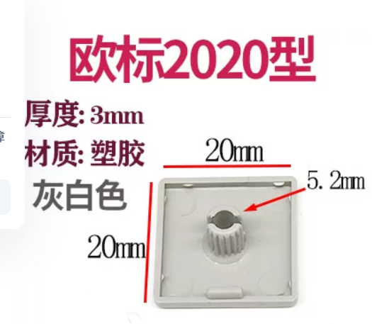

[返回表格](#item-4)

### 图2 加厚长孔角码

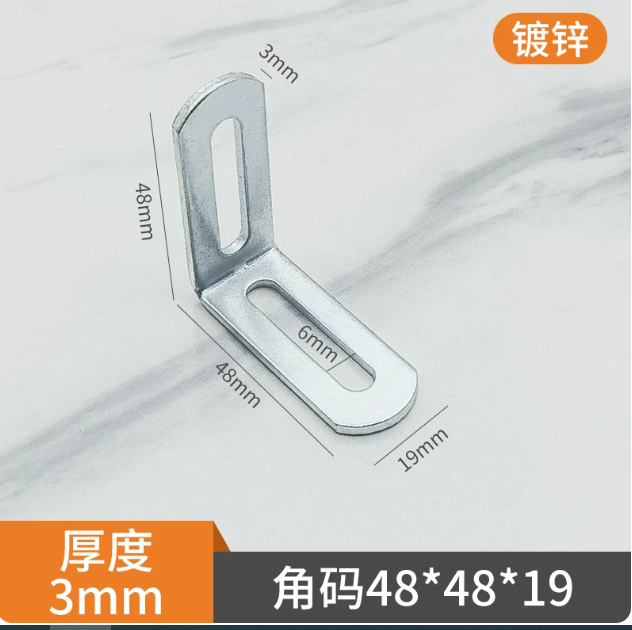

[返回表格](#item-5)

### 图3 不锈钢多功能角码

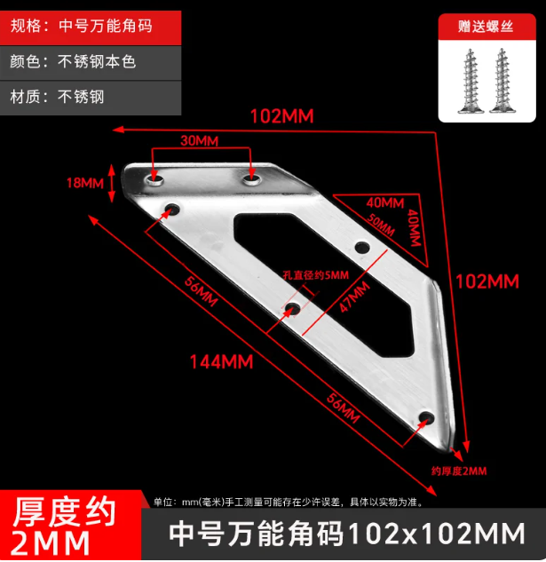

[返回表格](#item-6)

### 图4 垂直角件连接角

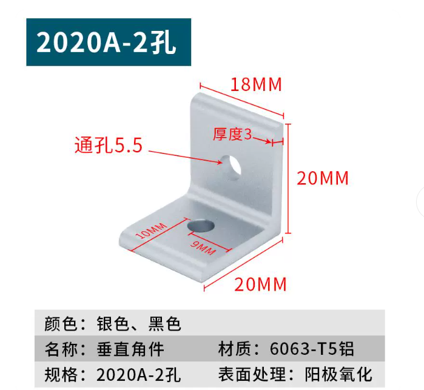

[返回表格](#item-7)

### 图5 三面固定角码

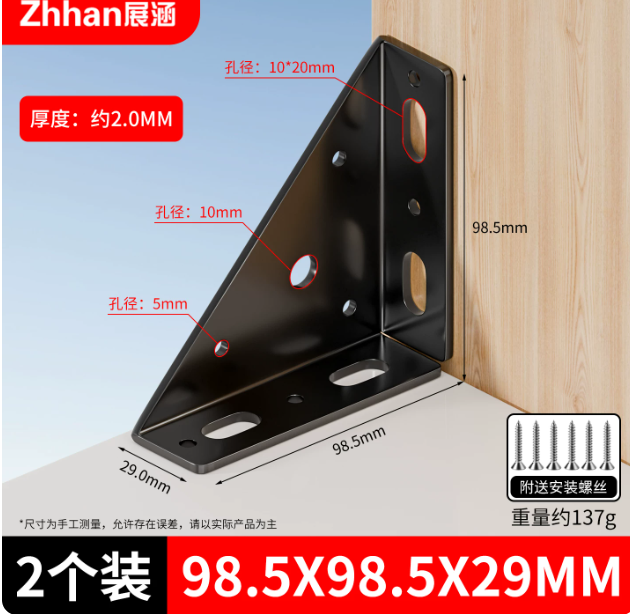

[返回表格](#item-8)

### 图6 铝型材地脚半圆连接件

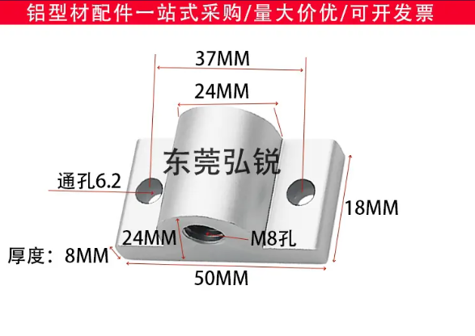

[返回表格](#item-9)

### 图7 橡胶轮胎及联轴器

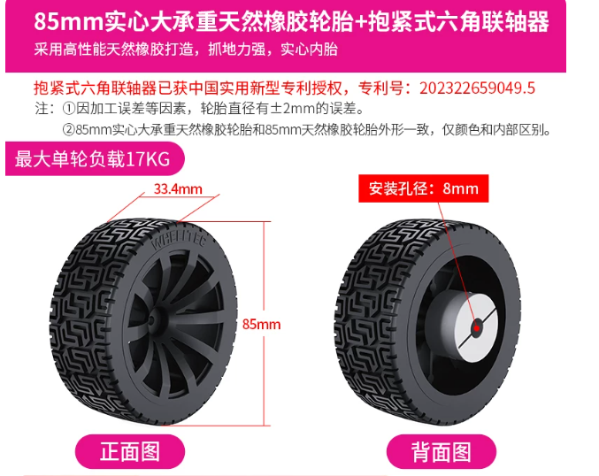

[返回表格](#item-12)

### 图8 钢制法兰联轴器及舵盘连接件

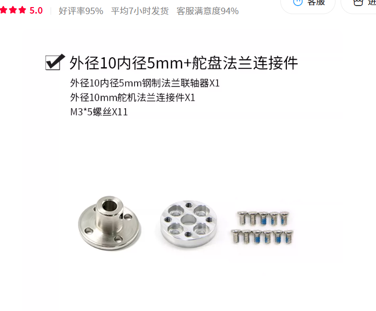

[返回表格](#item-13)

### 图9 钢制法兰联轴器及舵盘连接件

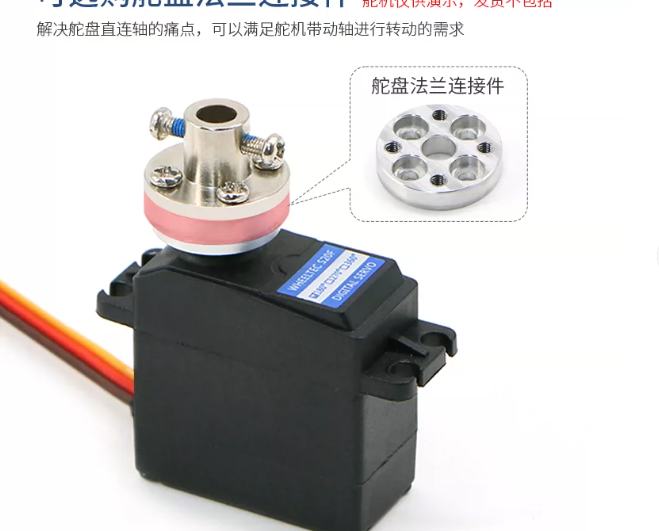

[返回表格](#item-13)

### 图10 钢制法兰联轴器及舵盘连接件

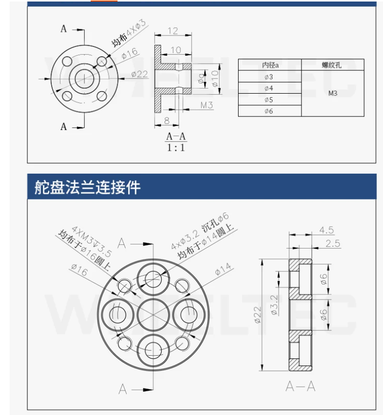

[返回表格](#item-13)

### 图11 立式外球面轴承座

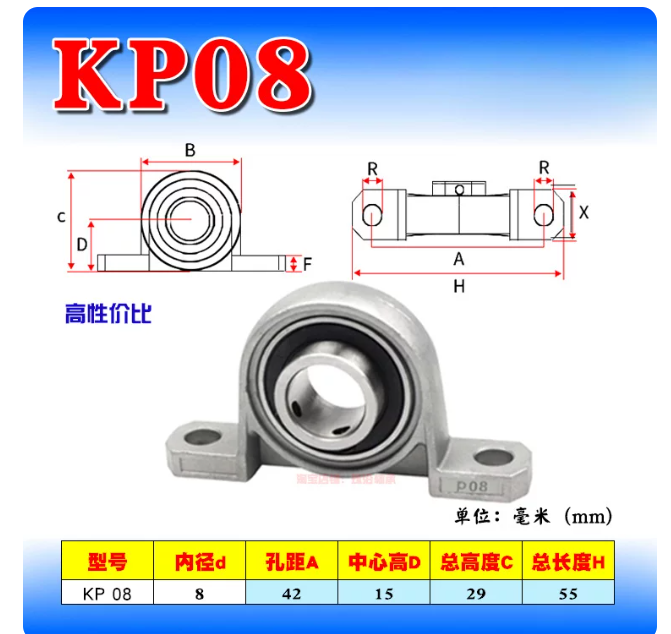

[返回表格](#item-14)

### 图12 轴承钢硬轴／光轴

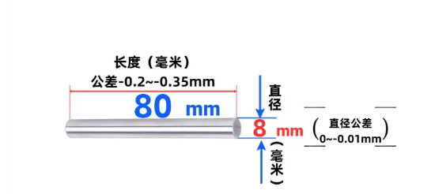

[返回表格](#item-15)

### 图13 刚性联轴器

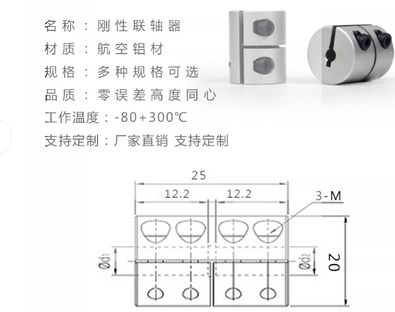

[返回表格](#item-16)

### 图14 GX80双导轨滚珠丝杆滑台

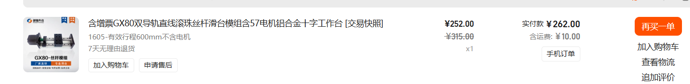

[返回表格](#item-17)

### 图15 塑料尼龙拖链

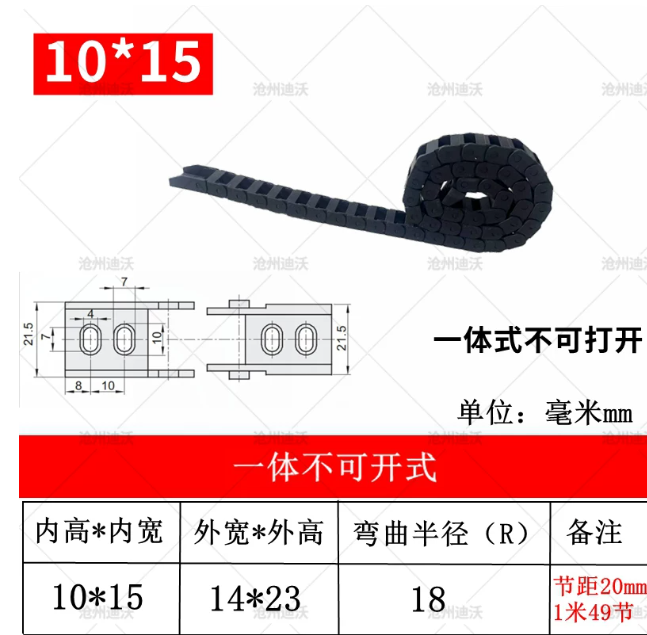

[返回表格](#item-21)

### 图16 椭圆孔扁铁条／固定片

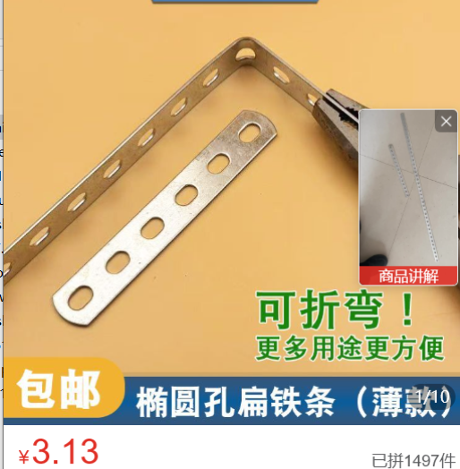

[返回表格](#item-20)

### 图17 椭圆孔扁铁条／固定片

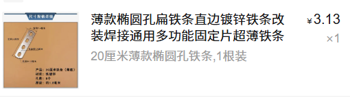

[返回表格](#item-20)

### 图18 微动行程开关

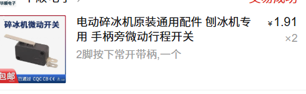

[返回表格](#item-22)

### 图19 舵机

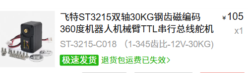

[返回表格](#item-29)

### 图20 白色PP板

[返回表格](#item-37)

### 图21 万能连接片

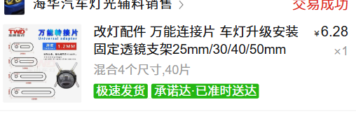

[返回表格](#item-10)

### 图22 螺丝螺母垫片套装

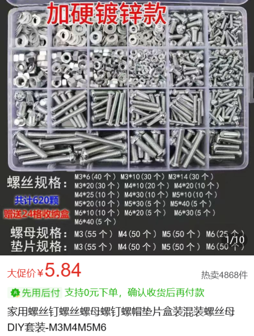

[返回表格](#item-34)

### 图23 USB3.0集线器

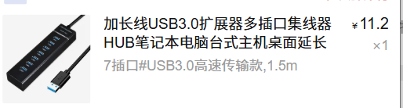

[返回表格](#item-23)

### 图24 DC5521一拖二延长线

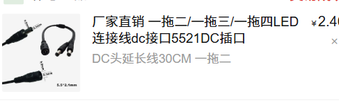

[返回表格](#item-24)

### 图25 DC5521电源线

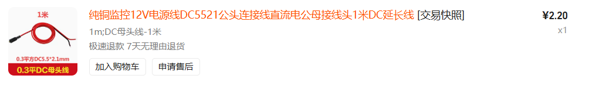

[返回表格](#item-25)

### 图26 42步进电机（驱动器一体闭环，主选）

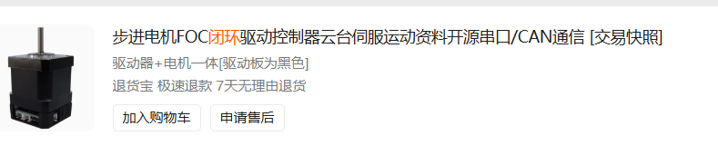

[返回表格](#item-27)

### 图27 XH2.54 4P接头线

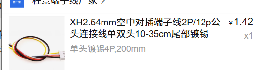

[返回表格](#item-27)

### 图28 2028单角码

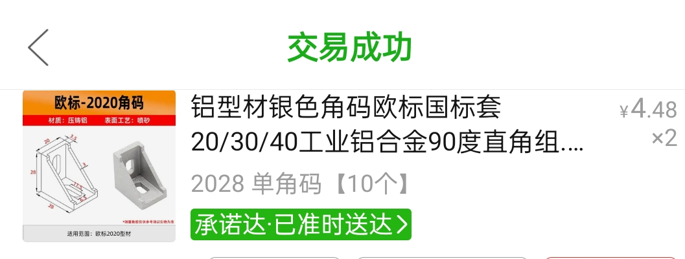

[返回表格](#item-11)

